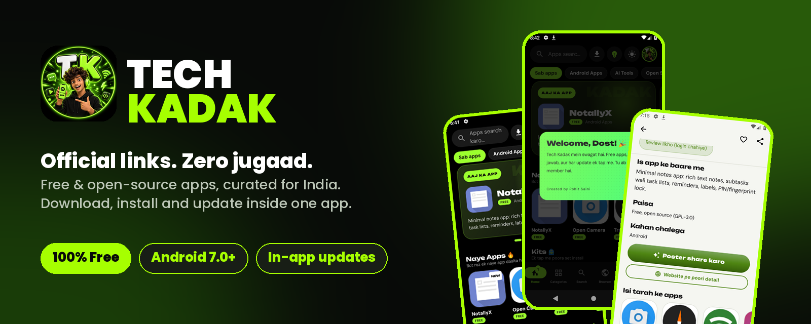
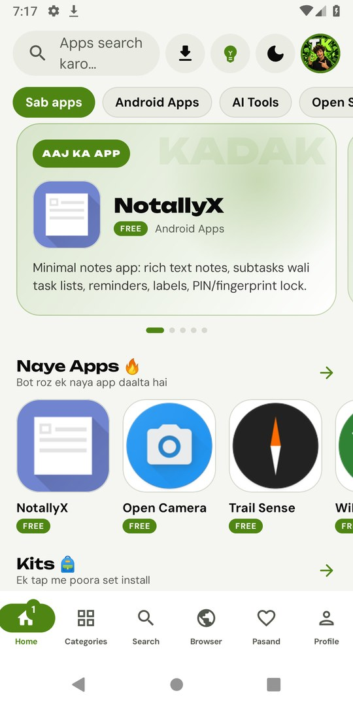
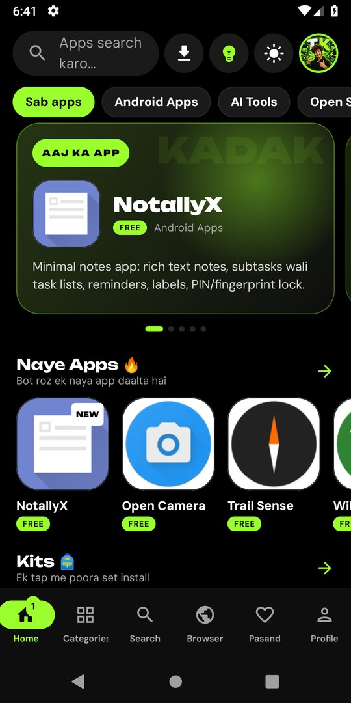
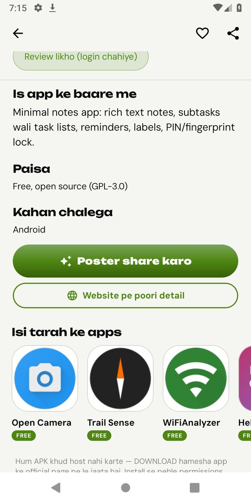
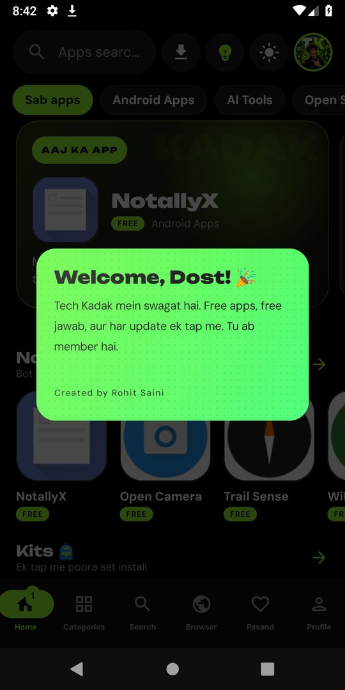
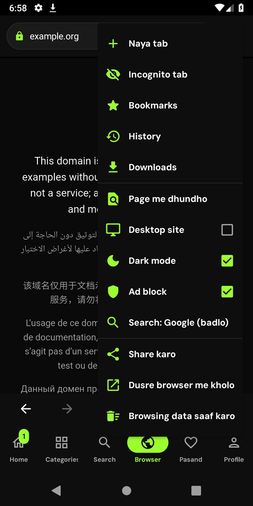
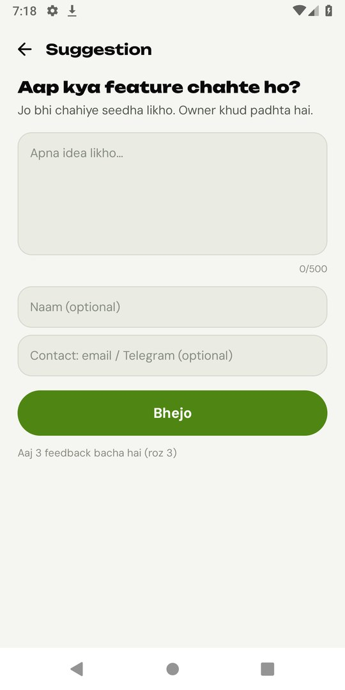

 

### [⬇️&nbsp;&nbsp;Download the latest version](https://github.com/techkadak/techkadak-app/releases/latest)

**Free and open-source apps, one official link each. Install, open and update them from one app.**

[Website](https://techkadak.github.io) · [Instagram](https://www.instagram.com/techkadak/) · [YouTube](https://www.youtube.com/channel/UCpxdwzHB-66cPyssRH5IaTA) · [Telegram](https://t.me/techkadak)

---

## ⬇️ Latest version

<!-- LATEST:START -->
| | |
|---|---|
| **Version** | **v1.5.0** |
| **Released** | 5 Nov 2026 |
| **APK size** | 5.16 MB (5,164,485 bytes) |
| **Requires** | Android 7.0+ |
| **SHA-256** | `9872b77be16a8c13510c80ef5227d659d6ce7a68ab40acd1f3f497efa72fdf49` |
| **Direct APK** | [TechKadak-v1.5.0.apk](https://github.com/techkadak/techkadak-app/releases/download/v1.5.0/TechKadak-v1.5.0.apk) |
<!-- LATEST:END -->

> The button above always opens the newest stable release. The table is refreshed automatically when a new release is published. See [how to check the file](docs/VERIFY.md) before you install.

**Install in 3 steps**

1. Download the APK from the latest release.
2. Open it. If Android asks, allow *Install unknown apps* for your browser or file manager.
3. Tap **Install**. After that, Tech Kadak tells you about updates inside the app.

Already on an older version? Just install over it, your data stays. The in-app update does the same thing for you. More detail: [docs/INSTALL.md](docs/INSTALL.md).

## ✨ About

**Tech Kadak** is a free Android app that collects useful free and open-source apps in one place, sorted by category, each with its official download link. No fake mirrors, no random APK sites. Hinglish by default, English if you prefer.

Made in India by [Rohit Saini](https://t.me/techkadak).

## 📸 Screenshots

<table>
  <tr>
    <td align="center"> Home</td>
    <td align="center"> Dark theme</td>
    <td align="center"> App details</td>
  </tr>
  <tr>
    <td align="center"> Member card</td>
    <td align="center"> In-app browser</td>
    <td align="center"> Feature suggestions</td>
  </tr>
</table>

Screenshots are from the real app (v1.5.0) running on an Android 9 emulator.

## 🚀 Key features

| | |
|---|---|
| 🧭 **Official links only** | Every app points to its official GitHub, F-Droid or website page. |
| 📲 **Install inside the app** | In-app Install, Open and Update with background download and progress. |
| 🎒 **Kits** | A full set in one tap: Student, Creator, Phone cleaning, Privacy, Office, Music and Video. |
| 🌐 **In-app browser** | Search, tabs, downloads, bookmarks, history and incognito, built into the app. |
| 🖼️ **Official screenshots** | Swipe through each app's own screenshots before you install. |
| ⭐ **Real reviews** | Write a review (login needed). Only real reviews, nothing fake. |
| 💡 **Suggest a feature** | Tap the bulb at the top and tell us what you want next. |
| 🎨 **Make it yours** | AMOLED, Dark and Light themes, accent colours, font size, Hinglish or English. |
| 🔐 **Optional login** | Google, email or phone. You can skip it. |
| 🪪 **Member card** | An animated card with your member number, also in Profile. |
| 🖼️ **Share posters** | Make a poster of any app for WhatsApp or Instagram. |
| 🔔 **Update card** | A cancellable card when a new version is out. Never forced. |

## 🆕 What's new in v1.5.0

- New opening animation (can be switched off in Settings)
- Browser tab with search, tabs, downloads, bookmarks, history and incognito
- Official screenshots on app pages
- Reviews (login needed, real reviews only)
- Feature suggestion bulb in the top bar
- Member card for everyone after the update, and for new accounts. Also in Profile
- New update card, QR code in About
- Optional support button (Rs 50)
- Bug fixes and smoother scrolling

Full list: [changelog/CHANGELOG.md](changelog/CHANGELOG.md)

## 🕘 Version history

| Version | Date | Highlights |
|---|---|---|
| [v1.5.0](https://github.com/techkadak/techkadak-app/releases/tag/v1.5.0) | 5 Nov 2026 | Browser, reviews, member card, official screenshots, new update card |
| [v1.3.0](https://github.com/techkadak/techkadak-app/releases/tag/v1.3.0) | 4 Nov 2026 | New pull-to-refresh animation |
| [v1.2.1](https://github.com/techkadak/techkadak-app/releases/tag/v1.2.1) | 4 Nov 2026 | Fix for a crash on launch in v1.2.0 |
| [v1.2.0](https://github.com/techkadak/techkadak-app/releases/tag/v1.2.0) | 3 Nov 2026 | Kits, share poster, videos, Liquid Glass theme |
| [v1.1.0](https://github.com/techkadak/techkadak-app/releases/tag/v1.1.0) | 3 Nov 2026 | In-app install, themes, login, widget |

All older releases stay available on the [Releases page](https://github.com/techkadak/techkadak-app/releases).

## 🧩 System requirements

- Android **7.0 or newer**
- About **5 MB** of free space for the app, plus room for the apps you install
- Internet connection for browsing the catalogue and downloading apps

## 🔭 What's next

We build what people ask for. Use the bulb inside the app or message us on [Telegram](https://t.me/techkadak). Nothing is listed here until it actually ships.

## ❓ FAQ

<b>Is Tech Kadak free?</b>

Yes. There is no paywall. An optional Rs 50 support button exists if you want to help.

<b>Do I need to log in?</b>

No. Login (Google, email or phone) is optional. You need it only to write reviews.

<b>Is it safe to install?</b>

Download only from this page or from <a href="https://techkadak.github.io">techkadak.github.io</a>. Every release is signed with the same key. You can check the SHA-256 and the signing certificate, see <a href="docs/VERIFY.md">docs/VERIFY.md</a>. The app also warns you if it is a modified copy.

<b>How do updates work?</b>

When a new release is published here, the app shows an update card. You can say "later". Updates install over your current version and keep your data.

<b>What data do you collect?</b>

Anonymous usage stats and a random install ID. You can turn the stats off in Settings. Details: <a href="docs/PRIVACY.md">docs/PRIVACY.md</a>.

<b>The app crashed. What do I do?</b>

Open it again. A pop-up offers "Report copy karo". Send us that text on <a href="https://t.me/techkadak">Telegram</a>.

<b>Is there an iPhone version?</b>

There is a separate unsigned iOS build in <a href="https://github.com/techkadak/techkadak-ios">techkadak-ios</a>. It is a different, simpler app. This repository is for Android.

## 💬 Contact and support

- Telegram: [t.me/techkadak](https://t.me/techkadak) (app requests, bug reports)
- Instagram: [@techkadak](https://www.instagram.com/techkadak/)
- YouTube: [Tech Kadak](https://www.youtube.com/channel/UCpxdwzHB-66cPyssRH5IaTA)
- Website: [techkadak.github.io](https://techkadak.github.io)
- Guidelines: [CONTRIBUTING.md](CONTRIBUTING.md)

## 👤 Credits

Created by **Rohit Saini** · Made with 💚 in India

Tech Kadak. Official links. Zero jugaad.

